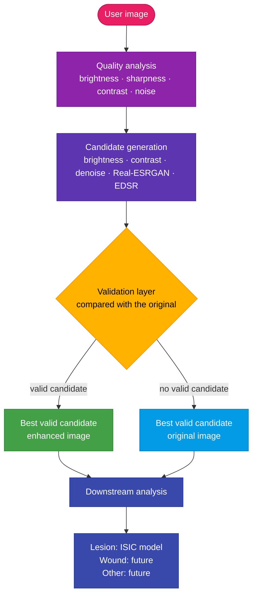
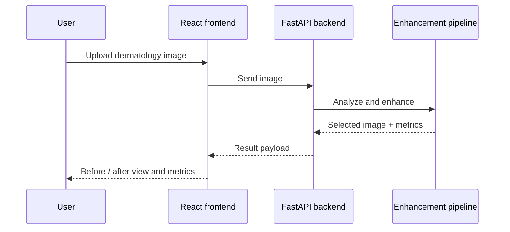
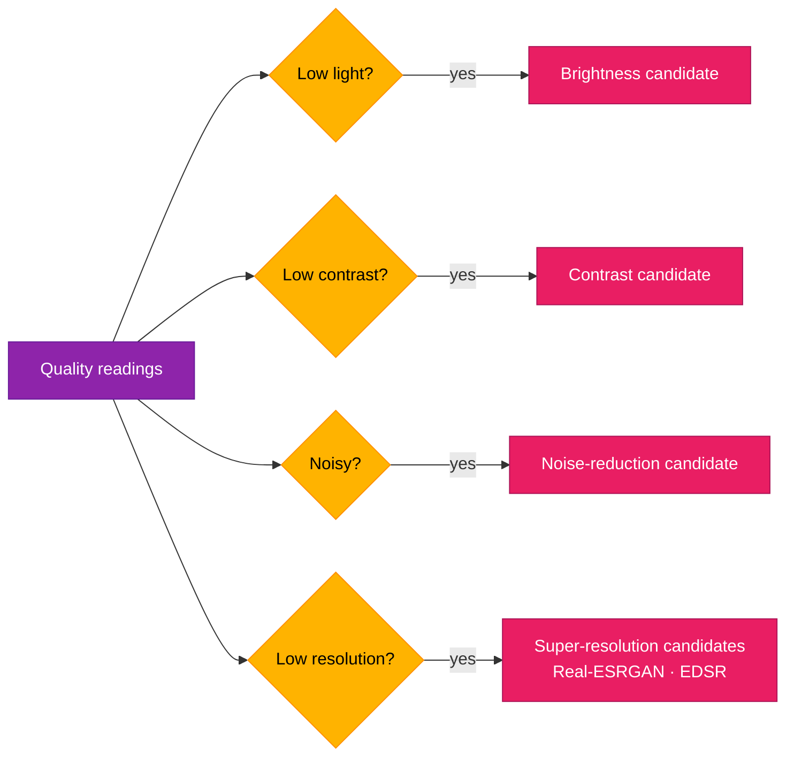
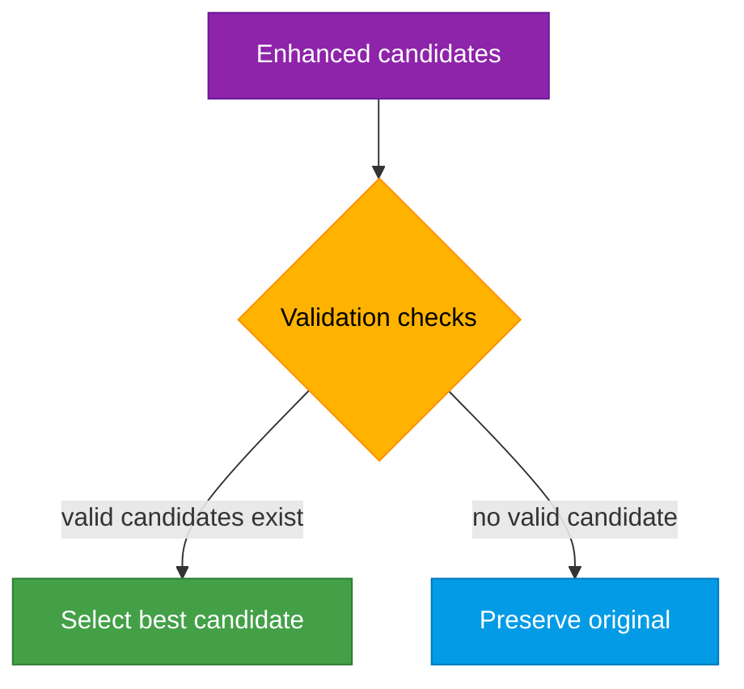
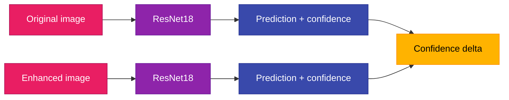
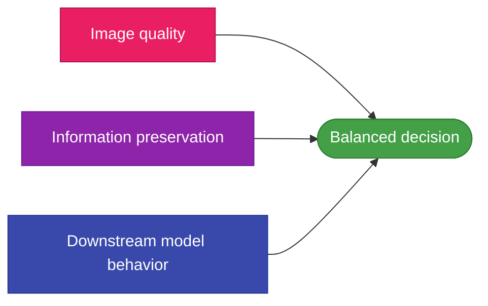
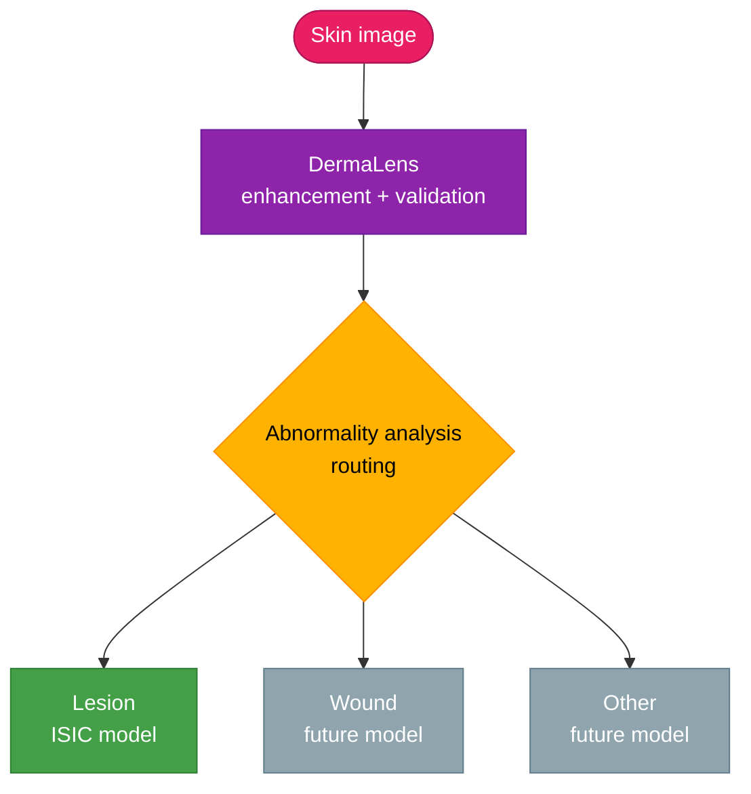
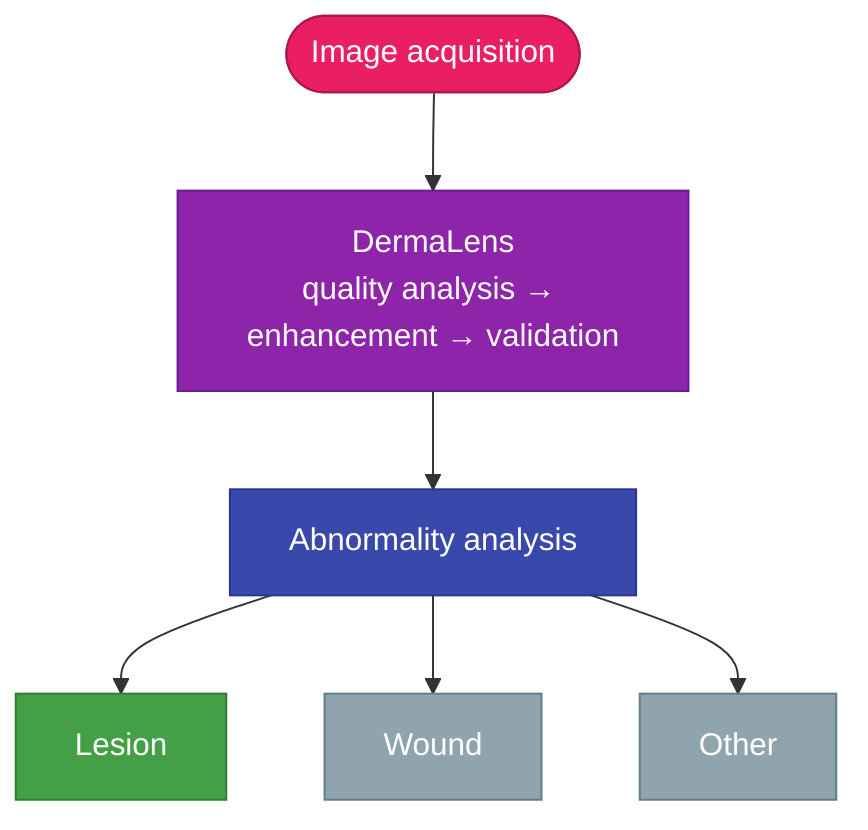

<!-- HEADER (no image files needed: everything below loads from shields.io) -->
<div align="center">

<h1>DermaLens 🧠🩺</h1>

<h3>Domain-aware dermatology image enhancement &amp; validation</h3>

<p>
  
  
  
</p>

<p>
  
  
  
  
  
  
  
</p>

<p>
  
  
  
  
  
  
</p>

</div>

<!-- Optional gradient banner: upload assets/banner.svg to your repo, then add
     <p align="center"></p> above the <h1>. -->

<p align="center">
  <a href="#-overview">Overview</a> ·
  <a href="#-problem">Problem</a> ·
  <a href="#-solution">Solution</a> ·
  <a href="#-system-architecture">Architecture</a> ·
  <a href="#-how-it-works">How It Works</a> ·
  <a href="#-core-design-principle">Design Principle</a> ·
  <a href="#-features">Features</a> ·
  <a href="#-tech-stack">Tech Stack</a> ·
  <a href="#-project-structure">Structure</a> ·
  <a href="#-how-to-run">Run</a> ·
  <a href="#-evaluation">Evaluation</a> ·
  <a href="#-current-status">Status</a> ·
  <a href="#-limitations">Limitations</a>
</p>

> [!WARNING]
> DermaLens is a **research prototype**, not a diagnostic device. Enhancement can introduce artifacts or change visual characteristics. Always keep the original image for comparison, and do not use any output as a substitute for assessment by a qualified clinician.

---

## 🧭 Table of Contents

| # | Section | What you will find |
|:-:|---|---|
| 1 | [Overview](#-overview) | What DermaLens is and the one-line goal |
| 2 | [Problem](#-problem) | Why fixed preprocessing fails on real-world skin images |
| 3 | [Solution](#-solution) | The adaptive, candidate-based approach |
| 4 | [System Architecture](#-system-architecture) | End-to-end flow of the pipeline |
| 5 | [How It Works](#-how-it-works) | Upload, analysis, candidates, validation, selection, downstream AI |
| 6 | [Core Design Principle](#-core-design-principle) | Why sharper and more confident does not mean better |
| 7 | [Features](#-features) | Everything the system does today |
| 8 | [Tech Stack](#-tech-stack) | Frontend, backend, ML and models |
| 9 | [Project Structure](#-project-structure) | Full directory tree |
| 10 | [How to Run](#-how-to-run) | Backend and frontend setup |
| 11 | [Evaluation](#-evaluation) | Metrics and a worked example |
| 12 | [Validation Philosophy](#-validation-philosophy) | Balancing quality, preservation and model behavior |
| 13 | [Future Abnormality Analysis](#-future-abnormality-analysis) | Routing images to specialized models |
| 14 | [Limitations](#-limitations) | What DermaLens is not |
| 15 | [Future Improvements](#-future-improvements) | Roadmap by area |
| 16 | [Project Goal](#-project-goal) | The question DermaLens investigates |
| 17 | [Current Status](#-current-status) | Implemented, in progress, planned |
| 18 | [Glossary](#-glossary) | Metrics and models explained |
| 19 | [FAQ](#-faq) | Common questions |
| 20 | [Author](#-author) | Who built it |

---

## ✨ Overview

DermaLens is a **domain-aware dermatology image enhancement and validation framework**, designed to improve degraded skin images *before* downstream abnormality analysis.

Real-world dermatology images are often captured with ordinary phone cameras, and can contain:

| Degradation | Typical cause |
|---|---|
| Low illumination | Dim rooms, shadows, poor lighting |
| Blur | Hand shake, missed focus |
| Motion artifacts | Movement during capture |
| Sensor noise | Small camera sensors in low light |
| Compression artifacts | Messaging apps and heavy JPEG compression |
| Poor contrast | Flat lighting, washed-out exposure |
| Limited resolution | Low-end cameras, cropping, downscaling |

Instead of applying a fixed preprocessing operation to every image, DermaLens analyzes the input image and generates **multiple enhancement candidates**. Each candidate is evaluated using image-quality and preservation metrics before the system selects the most suitable result.

The goal is not simply to make an image look sharper.

> [!IMPORTANT]
> **The goal is to make the image clearer while preserving the visual structures and information present in the original image.**

### At a glance

| 1. Analyze | 2. Generate | 3. Validate | 4. Decide |
|:---:|:---:|:---:|:---:|
| Brightness, sharpness, contrast and noise of the original | Targeted candidates: illumination, contrast, denoising, Real-ESRGAN, EDSR | Each candidate is checked against the original for structure, color and noise | Best valid candidate is used; otherwise the **original is preserved** |

---

## 🚨 Problem

Dermatology images collected outside controlled imaging environments can vary significantly in quality.

A downstream AI model may receive an image that is:

- Too dark
- Blurry
- Noisy
- Low contrast
- Compressed
- Captured at insufficient resolution

Traditional preprocessing pipelines often apply the **same transformation regardless of image quality**.

Aggressive enhancement can introduce problems such as:

| Side effect | Why it matters for skin images |
|---|---|
| Artificial textures | Synthetic detail can look like real skin structure |
| False edges | Can create lesion boundaries that do not exist |
| Color shifts | Pigmentation is clinically meaningful |
| Noise amplification | Can obscure subtle features |
| Loss of subtle structures | Fine patterns can be smoothed away |
| Over-sharpening | Halos and ringing around real structures |

Therefore:

> [!CAUTION]
> **Higher numerical sharpness does not necessarily mean a better dermatology image.**

DermaLens treats enhancement as a **validation problem**, rather than a simple image-processing problem.

---

## ✅ Solution

DermaLens uses an **adaptive, candidate-based enhancement pipeline**.

Instead of immediately modifying the uploaded image, the system:

1. Analyzes the original image.
2. Detects relevant quality problems.
3. Generates appropriate enhancement candidates.
4. Measures the effect of each candidate.
5. Rejects candidates that introduce excessive distortion.
6. Selects the best valid candidate.
7. Preserves the original image when no candidate provides a sufficiently safe improvement.
8. Passes the resulting image to downstream abnormality analysis.

<table>
  <tr>
    <th width="50%">Fixed preprocessing</th>
    <th width="50%">DermaLens</th>
  </tr>
  <tr>
    <td valign="top">

- Same operation for every image
- No check on what the operation did
- Enhancement is always applied
- Sharper is assumed to be better
- Risk of artifacts reaching the AI model

</td>
    <td valign="top">

- Operations chosen from detected problems
- Every candidate measured against the original
- Enhancement only kept when it is safe
- Multiple signals decide, not one metric
- Original preserved when nothing is safe

</td>
  </tr>
</table>

---

## ⚙️ System Architecture



<details>
<summary><b>Text version of the architecture diagram</b></summary>

```text

                         USER IMAGE

                             │

                             ▼

                  ┌─────────────────────┐

                  │   QUALITY ANALYSIS  │

                  │                     │

                  │ • Brightness        │

                  │ • Sharpness / Blur  │

                  │ • Contrast          │

                  │ • Noise             │

                  └──────────┬──────────┘

                             │

                             ▼

                 ┌─────────────────────────┐

                 │   CANDIDATE GENERATION  │

                 │                         │

                 │ • Brightness correction │

                 │ • Contrast enhancement  │

                 │ • Noise reduction       │

                 │ • Super-resolution      │

                 │ • Real-ESRGAN           │

                 │ • EDSR                  │

                 └────────────┬────────────┘

                              │

                              ▼

                  ┌───────────────────────────┐

                  │      VALIDATION LAYER     │

                  │                           │

                  │ • Quality improvement     │

                  │ • Exposure change         │

                  │ • Noise change            │

                  │ • Structural similarity   │

                  │ • Color shift             │

                  │ • Sharpness change        │

                  └─────────────┬─────────────┘

                                │

                                ▼

                  ┌──────────────────────┐

                  │ BEST VALID CANDIDATE │

                  │                      │

                  │ Enhanced image       │

                  │ OR                   │

                  │ Original image       │

                  └──────────┬───────────┘

                             │

                             ▼

                  ┌──────────────────────┐

                  │ DOWNSTREAM ANALYSIS  │

                  │                      │

                  │ Lesion → ISIC model  │

                  │ Wound  → future      │

                  │ Other  → future      │

                  └──────────────────────┘

```

</details>

### Stage summary

| Stage | Input | Output | Purpose |
|---|---|---|---|
| **Quality analysis** | Original image | Brightness, sharpness, contrast and noise readings | Decide which problems are present |
| **Candidate generation** | Image plus readings | Several enhanced candidates | Try targeted fixes, not a single blind one |
| **Validation layer** | Each candidate plus the original | Accept or reject, with scores | Reject distortion, artifacts and color shifts |
| **Best valid candidate** | Validated candidates | One image: enhanced or original | Safe selection with fallback |
| **Downstream analysis** | Selected image | Prediction and confidence | Route to the right abnormality model |

---

## 🧪 How It Works

### 1️⃣ Image Upload

The user uploads a dermatology image.

The application accepts common image formats and sends the image to the **FastAPI backend** for quality analysis and preprocessing.

The enhancement layer is designed to work with both:

- Curated dermatology datasets such as **ISIC**
- Real-world images captured using ordinary cameras

The preprocessing system does not assume that every image has the same quality characteristics.



---

### 2️⃣ Quality Analysis

The original image is analyzed **before** any enhancement.

Current measurements include:

| Measure | What it tells us |
|---|---|
| **Brightness** | Average illumination level of the image |
| **Sharpness** | Estimated with the variance of the Laplacian |
| **Contrast** | Intensity variation within the image |
| **Noise** | Evaluated during candidate comparison |

#### Brightness

Measures the average illumination level of the image.

Brightness is used to identify images that may require illumination correction.

#### Sharpness

Sharpness is estimated using the **variance of the Laplacian**.

A low Laplacian variance generally indicates a blurry image.

#### Contrast

Contrast measures intensity variation within the image.

Low contrast can indicate weak visual separation between image regions.

#### Noise

Noise characteristics are evaluated during candidate comparison to determine whether an enhancement operation introduces excessive noise.

---

### 3️⃣ Adaptive Candidate Generation

DermaLens does not blindly apply a single enhancement operation to every image.

Instead, the pipeline generates enhancement candidates **according to the detected image characteristics**.



Possible enhancement operations include:

#### Brightness Enhancement

Low-light images can undergo adaptive illumination correction using **LAB color-space processing** and **gamma adjustment**.

#### Contrast Enhancement

Images with insufficient contrast can undergo controlled contrast enhancement.

#### Noise Reduction

Noise reduction can be applied when image noise is detected.

The resulting candidate is then evaluated to determine whether the reduction in noise comes at the cost of important image structure.

#### Super Resolution

DermaLens supports AI-assisted super-resolution processing.

Current models include:

- **Real-ESRGAN**
- **EDSR**

The pipeline can use adaptive full-resolution processing when CPU constraints make direct EDSR processing impractical for the input image size.

---

### 4️⃣ Candidate Validation

Candidate generation alone is not enough.

Every candidate must be evaluated against the original image.

The validation layer currently considers factors such as:

| Factor | Question it answers |
|---|---|
| Quality improvement | Is the image measurably better overall? |
| Exposure improvement | Is the lighting closer to a usable range? |
| Sharpness change | Did sharpness improve, and by how much? |
| Noise change | Did the candidate add or remove noise? |
| Structural similarity | Is the underlying structure still the same? |
| Color shift | Did the colors drift from the original? |

This prevents the system from automatically selecting an image simply because it has a higher numerical sharpness score.

For example:

```text

Candidate A


Sharpness       ↑

Contrast        ↑

Noise           ↑↑

Structure       ↓


→ Rejected

```

while:

```text

Candidate B


Brightness      ↑

Sharpness       ↑

Noise           ≈

Structure       ≈

Color shift     Low


→ Potentially accepted

```

Side by side:

| Signal | Candidate A | Candidate B |
|---|:---:|:---:|
| Brightness | – | ↑ |
| Sharpness | ↑ | ↑ |
| Contrast | ↑ | – |
| Noise | ↑↑ | ≈ |
| Structure | ↓ | ≈ |
| Color shift | – | Low |
| **Outcome** | 🔴 **Rejected** | 🟢 **Potentially accepted** |

> [!TIP]
> The objective is **controlled improvement**, not maximum enhancement.

---

### 5️⃣ Best Candidate Selection

After candidate validation, DermaLens selects the **highest-scoring valid candidate**.

If none of the generated candidates satisfies the validation criteria, the **original image is preserved**.



```text

Enhanced candidates

        │

        ▼

Validation checks

        │

        ├── Valid candidate → Select best candidate

        │

        └── No valid candidate

                    │

                    ▼

             Preserve original

```

This creates a **safety-oriented fallback mechanism**.

The system therefore does not force an enhancement onto an image when the enhancement cannot demonstrate sufficient benefit.

---

### 6️⃣ Downstream AI Validation

After preprocessing, DermaLens can evaluate the resulting image using a dermatology classifier.

The current implementation uses a **ResNet18-based dermatology model**.

The model can be evaluated on both the original and enhanced images.



```text

Original Image

      │

      ▼

ResNet18

      │

      ▼

Prediction + Confidence


Enhanced Image

      │

      ▼

ResNet18

      │

      ▼

Prediction + Confidence

```

The system can then compare the resulting confidence values.

Example:

```text

Original Confidence  → 0.80

Enhanced Confidence  → 0.83


Confidence Delta      → +0.03

```

Model confidence is treated as a **downstream validation signal**, not as the sole definition of image quality.

> [!NOTE]
> A higher confidence score does not automatically mean that an enhancement is clinically correct.

---

## 🧠 Core Design Principle

DermaLens is built around the following principle:

> **Image enhancement should improve usability without unnecessarily changing the underlying visual information.**

A visually sharper image can still be worse if it introduces:

- Artificial patterns
- False lesion boundaries
- Incorrect pigmentation
- Synthetic textures
- Excessive noise
- Significant color distortion

Therefore:

```text

Higher Sharpness

        ≠

Better Dermatology Image

```

Similarly:

```text

Higher Model Confidence

        ≠

Clinical Correctness

```

DermaLens therefore evaluates enhancement using **multiple signals** rather than relying on a single metric.

| Principle | In practice |
|---|---|
| Enhancement must be earned | A candidate is only used if it passes validation |
| The original is the reference | Every candidate is compared with it |
| No single metric is truth | Quality, preservation and model behavior are balanced |
| Safe failure | When nothing is safe, the original is kept |
| Transparency | Before/after views and metrics are shown to the user |

---

## 🚀 Features

<table>
  <tr>
    <th>Analysis</th>
    <th>Enhancement</th>
    <th>Validation</th>
    <th>Interface</th>
  </tr>
  <tr>
    <td valign="top">

- Dermatology image upload
- Automatic image-quality analysis
- Low-light detection
- Blur detection
- Contrast analysis
- Noise analysis

</td>
    <td valign="top">

- Adaptive enhancement candidates
- Low-light correction
- Real-ESRGAN super-resolution
- EDSR super-resolution
- Noise reduction

</td>
    <td valign="top">

- Enhancement validation
- Structural preservation checks
- Color-shift monitoring
- Original-image safety fallback
- ResNet18 downstream confidence evaluation

</td>
    <td valign="top">

- FastAPI backend
- React + Vite frontend
- Animated AI processing interface
- Before/after quality comparison
- Responsive web interface

</td>
  </tr>
</table>

### Full feature list

- 📸 Dermatology image upload
- 🔍 Automatic image-quality analysis
- 🌙 Low-light detection and correction
- 🌫️ Blur detection
- 🎚️ Contrast analysis
- 🧹 Noise analysis
- 🤖 Adaptive enhancement candidates
- 🧠 Real-ESRGAN super-resolution
- 🧠 EDSR super-resolution
- 🛡️ Enhancement validation
- 📊 Before/after quality comparison
- 🧩 Structural preservation checks
- 🎨 Color-shift monitoring
- 🔄 Original-image safety fallback
- 🧠 ResNet18 downstream confidence evaluation
- ⚡ FastAPI backend
- 🎨 React + Vite frontend
- ✨ Animated AI processing interface
- 📱 Responsive web interface

---

## 🛠️ Tech Stack

| Layer | Technologies |
|---|---|
| Frontend | React, Vite, Tailwind CSS, Framer Motion |
| Backend | FastAPI, Python |
| Image processing | OpenCV, NumPy |
| Machine learning | PyTorch |
| Dermatology model | ResNet18 |
| Super-resolution | Real-ESRGAN, EDSR |
| API communication | Fetch / Axios |

<p align="center">
  
  
  
  
</p>

<p align="center">
  
  
  
  
  
</p>

---

## 📂 Project Structure

```text

dermalens/

│

├── backend/

│   │

│   ├── app/

│   │   │

│   │   ├── ml/

│   │   │   ├── degrade.py

│   │   │   ├── derm_model.py

│   │   │   ├── enhancement.py

│   │   │   ├── evaluate.py

│   │   │   ├── evaluate_derm.py

│   │   │   ├── generate_comparison_figure.py

│   │   │   ├── inference.py

│   │   │   ├── make_bad_images.py

│   │   │   ├── metrics.py

│   │   │   ├── pipeline.py

│   │   │   ├── prepare_data.py

│   │   │   ├── quality_analyzer.py

│   │   │   ├── superres_enhancer.py

│   │   │   ├── train_derm.py

│   │   │   │

│   │   │   ├── models/

│   │   │   │   └── isic_resnet18.pth

│   │   │   │

│   │   │   ├── realesrgan_weights/

│   │   │   │   └── realesr-general-x4v3.pth

│   │   │   │

│   │   │   └── weights/

│   │   │       └── EDSR_x2.pb

│   │   │

│   │   └── routes/

│   │       └── upload.py

│   │

│   ├── requirements.txt

│   └── test_realesrgan.py

│

└── frontend/

    │

    └── dermalens/

        │

        ├── src/

        │   ├── api/

        │   │   └── api.js

        │   │

        │   ├── assets/

        │   │   ├── hero.png

        │   │   ├── react.svg

        │   │   └── vite.svg

        │   │

        │   ├── components/

        │   │   ├── AIOrb.jsx

        │   │   ├── AIProcessing.jsx

        │   │   ├── BackgroundGlow.jsx

        │   │   ├── HeroSection.jsx

        │   │   ├── MetricsCard.jsx

        │   │   ├── Navbar.jsx

        │   │   ├── ResultSection.jsx

        │   │   ├── UploadBox.jsx

        │   │   └── UploadSection.jsx

        │   │

        │   ├── pages/

        │   │   └── Home.jsx

        │   │

        │   ├── App.css

        │   ├── App.jsx

        │   ├── index.css

        │   └── main.jsx

        │

        ├── package.json

        └── vite.config.js

```

| Area | Location |
|---|---|
| Enhancement, metrics, inference and training code | `backend/app/ml/` |
| Upload API route | `backend/app/routes/upload.py` |
| Dermatology model weights | `backend/app/ml/models/isic_resnet18.pth` |
| Real-ESRGAN weights | `backend/app/ml/realesrgan_weights/realesr-general-x4v3.pth` |
| EDSR weights | `backend/app/ml/weights/EDSR_x2.pb` |
| React components | `frontend/dermalens/src/components/` |
| Frontend API client | `frontend/dermalens/src/api/api.js` |

---

## ⚡ How to Run

### Backend

Navigate to the backend directory:

```bash

cd backend

```

Create a virtual environment:

```bash

python -m venv venv

```

Activate it.

**Windows (PowerShell):**

```bash

.\venv\Scripts\Activate.ps1

```

**Windows (Command Prompt):**

```bash

venv\Scripts\activate

```

**Linux / macOS / GitHub Codespaces:**

```bash

source venv/bin/activate

```

Install dependencies:

```bash

pip install -r requirements.txt

```

Start the FastAPI server:

```bash

python -m uvicorn app.main:app --reload --port 8000

```

The backend will be available at:

```text

http://127.0.0.1:8000

```

Open `http://127.0.0.1:8000/docs` to inspect the available routes. A `404` at `/` does not mean the server failed to start.

---

### Frontend

Navigate to the frontend:

```bash

cd frontend/dermalens

```

Install dependencies:

```bash

npm install

```

Start the development server:

```bash

npm run dev

```

The Vite development server will start on the configured development port. Open the local URL it prints, and confirm the frontend API base URL matches the backend address and port.

---

### Troubleshooting checklist

- [ ] Backend started and the FastAPI docs page loads
- [ ] Frontend started and the Vite page loads
- [ ] If no result appears after an upload, check the browser console and the backend terminal
- [ ] Check the API response fields before assuming a display issue comes from the enhancement pipeline
- [ ] Compare original and enhanced images; do not treat increased sharpness, a quality score or classifier confidence alone as evidence of clinical improvement

---

## 📊 Evaluation

DermaLens evaluates enhancement using **multiple image-level signals**.

### Image Quality

- Brightness
- Sharpness
- Contrast
- Noise
- Overall quality score

### Preservation

- Structural similarity
- Color shift
- Exposure change
- Noise change

### Downstream AI Evaluation

- Prediction before enhancement
- Prediction after enhancement
- Confidence before enhancement
- Confidence after enhancement
- Confidence delta

| Category | Signals | Question answered |
|---|---|---|
| **Image quality** | Brightness, sharpness, contrast, noise, overall score | Is the image more usable? |
| **Preservation** | Structural similarity, color shift, exposure change, noise change | Is the original information intact? |
| **Downstream AI** | Prediction and confidence before and after, confidence delta | How does the model react to the change? |

---

## 🧪 Example Evaluation

An example low-quality input may produce results such as:

```text

Original

────────────────────────────


Brightness       → 58.32

Sharpness        → 4.74

Contrast         → 6.89


Selected Candidate

────────────────────────────


Brightness       → 87.64

Sharpness        → 8.54

Contrast         → 8.28

Structure        → 0.995

```

| Metric | Original | Selected candidate |
|---|:---:|:---:|
| Brightness | 58.32 | 87.64 |
| Sharpness | 4.74 | 8.54 |
| Contrast | 6.89 | 8.28 |
| Structural similarity | – | 0.995 |

The system can then evaluate the downstream model:

```text

Confidence Before → 0.768

Confidence After  → 0.794


Δ Confidence      → +0.026

```

| Downstream signal | Before | After | Delta |
|---|:---:|:---:|:---:|
| ResNet18 confidence | 0.768 | 0.794 | +0.026 |

The exact values depend on the uploaded image.

---

## 🔬 Validation Philosophy

DermaLens deliberately avoids treating a single metric as the ground truth.

For example, a candidate may produce:

```text

Sharpness ↑↑

```

but simultaneously:

```text

Noise ↑↑

Color Shift ↑

Structure Similarity ↓

```

Such a candidate should not automatically be considered better.

The framework therefore attempts to balance:

```text

Image Quality

      +

Information Preservation

      +

Downstream Model Behavior

```

rather than optimizing only for visual sharpness.



---

## 🩺 Future Abnormality Analysis

The long-term architecture separates **image preparation** from **abnormality analysis**.

The enhancement layer can prepare an image without needing to know which abnormality is present.

The downstream analysis layer can then route the image to an appropriate specialized model.



<details>
<summary><b>Text version of the routing diagram</b></summary>

```text

                         Skin Image

                             │

                             ▼

                    ┌─────────────────┐

                    │    DermaLens    │

                    │ Enhancement +   │

                    │   Validation    │

                    └────────┬────────┘

                             │

                             ▼

                    Abnormality Analysis

                             │

              ┌──────────────┼──────────────┐

              │              │              │

              ▼              ▼              ▼

           Lesion          Wound          Other

              │              │              │

              ▼              ▼              ▼

         ISIC Model      Future Model    Future Model

```

</details>

This architecture allows the preprocessing framework to remain **independent from individual abnormality classifiers**.

| Route | Model | Status |
|---|---|---|
| Lesion | ISIC ResNet18 | 🟢 Available |
| Wound / cut | Dedicated model | 🔵 Planned |
| Other abnormalities | Additional models | 🔵 Planned |

---

## ⚠️ Limitations

> [!CAUTION]
> DermaLens is currently a **research and prototype framework**, not a clinically validated diagnostic system.

Important limitations include:

- No paired real-world degraded/clean dermatology dataset
- Potential distribution mismatch between curated datasets and real-world phone-camera images
- Traditional image-quality metrics may not perfectly represent perceptual or clinical quality
- Super-resolution models may introduce synthetic details
- Model confidence is not equivalent to clinical correctness
- Current downstream classification coverage is limited
- Wound/cut abnormality analysis is not yet integrated
- No clinical expert validation has been performed
- No prospective clinical evaluation has been performed

Therefore, DermaLens should **not be used as a standalone diagnostic system**.

| Limitation | Practical consequence |
|---|---|
| No paired real-world dataset | Reference-based metrics cannot be computed on real captured images |
| Dataset distribution mismatch | Behavior on phone-camera images may differ from curated data |
| Metric limitations | A good score does not guarantee a perceptually or clinically better image |
| Synthetic detail from super-resolution | Added texture may not exist in the real skin |
| Confidence is not correctness | A confident prediction can still be wrong |
| Limited downstream coverage | Only the lesion route is available today |
| No clinical validation | Not suitable for clinical decisions |

---

## 🔮 Future Improvements

### Enhancement

- Learned image-quality assessment
- Domain-specific enhancement models
- Improved motion-blur restoration
- Compression-artifact correction
- Better low-light restoration
- Adaptive enhancement threshold optimization
- Paired dermatology degradation datasets
- Domain-specific super-resolution models

### Evaluation

Planned evaluation metrics include:

- PSNR
- SSIM
- LPIPS
- Perceptual quality evaluation
- Human expert evaluation
- Cross-camera robustness testing
- Cross-lighting-condition evaluation

PSNR and SSIM are particularly useful when paired reference images are available.

For unpaired real-world images, perceptual and preservation-based evaluation will be more appropriate.

### Explainability

- Grad-CAM
- Lesion localization
- Abnormality-region highlighting
- Model uncertainty visualization
- Enhancement-region visualization

### Abnormality Analysis

- Specialized lesion classification
- Wound/cut classification
- Other skin abnormality models
- Multi-model routing
- Abnormality localization

### Deployment

- Mobile inference
- Edge deployment
- Telemedicine integration
- Real-time camera processing
- Lightweight model optimization

### Roadmap at a glance

| Area | Focus |
|---|---|
| **Enhancement** | Learned quality assessment, domain-specific models, better restoration, paired degradation datasets |
| **Evaluation** | PSNR, SSIM, LPIPS, perceptual and expert evaluation, robustness testing |
| **Explainability** | Grad-CAM, localization, uncertainty and enhancement-region visualization |
| **Abnormality analysis** | Specialized lesion and wound/cut models, multi-model routing |
| **Deployment** | Mobile, edge, telemedicine, real-time camera, lightweight models |

---

## 🎯 Project Goal

DermaLens investigates a fundamental problem in medical AI:

> [!NOTE]
> **Can degraded medical images be improved before AI analysis without introducing changes that make the image less trustworthy?**

Instead of treating preprocessing as a fixed sequence of filters, DermaLens treats it as a **decision-making and validation layer between image acquisition and downstream AI analysis**.



<details>
<summary><b>Text version of the goal diagram</b></summary>

```text

              IMAGE ACQUISITION

                     │

                     ▼

             ┌───────────────┐

             │   DermaLens   │

             │               │

             │ Quality       │

             │ Analysis      │

             │      ↓        │

             │ Enhancement   │

             │      ↓        │

             │ Validation    │

             └───────┬───────┘

                     │

                     ▼

             ABNORMALITY ANALYSIS

                     │

          ┌──────────┼──────────┐

          ▼          ▼          ▼

        Lesion      Wound      Other

```

</details>

---

## 📌 Current Status

### 🟢 Implemented

- [x] Image upload and preprocessing API
- [x] Image-quality analysis
- [x] Brightness analysis and correction
- [x] Blur/sharpness detection
- [x] Contrast analysis
- [x] Noise analysis
- [x] Adaptive enhancement pipeline
- [x] Candidate generation
- [x] Candidate validation
- [x] Quality-based candidate selection
- [x] Original-image safety fallback
- [x] ResNet18 dermatology model
- [x] Real-ESRGAN integration
- [x] EDSR integration
- [x] Downstream confidence comparison
- [x] Enhancement acceptance/rejection logic
- [x] FastAPI backend
- [x] React + Vite frontend
- [x] Animated AI processing interface
- [x] Before/after result interface
- [x] Enhancement metrics display
- [x] Model weights integrated into the project

### 🟡 In Progress

- [ ] Improved result visualization
- [ ] Image quality analysis panel
- [ ] Compare / zoom interaction
- [ ] Quality-change visualization
- [ ] Downstream abnormality analysis workflow

### 🔵 Planned

- [ ] PSNR / SSIM evaluation
- [ ] LPIPS evaluation
- [ ] Wound/cut analysis
- [ ] Additional abnormality models
- [ ] Grad-CAM explainability
- [ ] Real-world dataset evaluation
- [ ] Clinical expert evaluation
- [ ] Mobile / edge deployment

| Stage | Items | Meaning |
|---|:---:|---|
| 🟢 Implemented | 22 | Working in the current prototype |
| 🟡 In progress | 5 | Actively being built |
| 🔵 Planned | 8 | On the roadmap |

---

## 📖 Glossary

<details>
<summary><b>Metrics and measurements</b></summary>

| Term | Meaning |
|---|---|
| **Brightness** | Average intensity of the image; a low value suggests under-exposure |
| **Contrast** | How widely pixel intensities are spread; low contrast looks flat or washed out |
| **Sharpness** | How crisp edges and fine detail are |
| **Variance of the Laplacian** | A common focus measure: the Laplacian highlights edges, and low variance of the result generally indicates blur |
| **Noise** | Random variation in pixel values, often from small sensors in low light |
| **Structural similarity (SSIM)** | A measure of how similar the structure of two images is, on a scale where 1 means identical |
| **PSNR** | Peak signal-to-noise ratio; compares an image with a clean reference, so it needs paired images |
| **LPIPS** | Learned Perceptual Image Patch Similarity; a learned measure of perceptual difference |
| **Color shift** | How far the colors of a candidate drift from the original |
| **Confidence delta** | Change in the classifier's confidence between the enhanced and original image |

</details>

<details>
<summary><b>Techniques and models</b></summary>

| Term | Meaning |
|---|---|
| **LAB color space** | A color space that separates lightness from color, so brightness can be adjusted with less color distortion |
| **Gamma adjustment** | A nonlinear brightness correction that lifts dark regions more than bright ones |
| **Super-resolution** | Reconstructing a higher-resolution image from a lower-resolution one |
| **Real-ESRGAN** | A GAN-based restoration and upscaling model designed for real-world degradations |
| **EDSR** | Enhanced Deep Super-Resolution, a deep residual network for upscaling |
| **ResNet18** | An 18-layer residual convolutional network, used here as the dermatology classifier |
| **ISIC** | The International Skin Imaging Collaboration, a public archive of dermatology images used for training and benchmarking |
| **Grad-CAM** | A method that highlights which image regions influenced a model's prediction |
| **Candidate** | One possible enhanced version of the input image |
| **Validation layer** | The component that accepts or rejects candidates by comparing them with the original |

</details>

---

## ❓ FAQ

<details>
<summary><b>Does DermaLens always enhance the image?</b></summary>
<br />

No. Every candidate is validated against the original. If none of them shows a sufficiently safe improvement, the original image is preserved.

</details>

<details>
<summary><b>Is DermaLens a diagnostic tool?</b></summary>
<br />

No. It is a research prototype that prepares and validates images before downstream analysis. It has not been clinically validated and must not be used as a standalone diagnostic system.

</details>

<details>
<summary><b>Why not just pick the sharpest result?</b></summary>
<br />

A sharper image can contain artificial patterns, false edges or color distortion. DermaLens balances image quality, information preservation and downstream model behavior instead of maximizing one metric.

</details>

<details>
<summary><b>Does a higher model confidence mean the enhancement is better?</b></summary>
<br />

No. Confidence is used as a downstream validation signal only. It is not equivalent to clinical correctness, and it is not the sole definition of image quality.

</details>

<details>
<summary><b>Which models does DermaLens use?</b></summary>
<br />

Real-ESRGAN and EDSR for super-resolution candidates, and a ResNet18-based dermatology model (the ISIC model used on the lesion route) for downstream confidence evaluation.

</details>

<details>
<summary><b>Why are PSNR and SSIM listed as planned evaluation metrics?</b></summary>
<br />

They are most informative when paired reference images exist. For unpaired real-world images, perceptual and preservation-based evaluation is more appropriate, which is why those metrics are on the roadmap alongside LPIPS.

</details>

<details>
<summary><b>What happens on limited hardware?</b></summary>
<br />

The pipeline can use adaptive full-resolution processing when CPU constraints make direct EDSR processing impractical for the input image size.

</details>

<details>
<summary><b>Which abnormalities are supported today?</b></summary>
<br />

The lesion route, through the ISIC model. Wound/cut analysis and other abnormality models are planned.

</details>

---

## 👩‍💻 Author

### Stuti Katiyar

Engineering · AI/ML · Computer Vision

---

<div align="center">

<h3>DermaLens: Enhance carefully. Validate before trusting.</h3>

<p>
  
  
  
</p>

</div>
